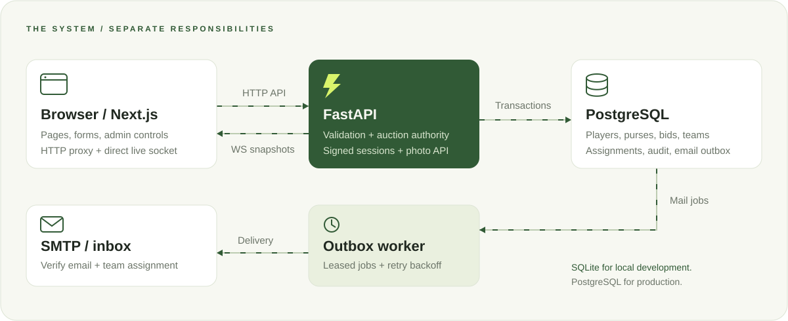
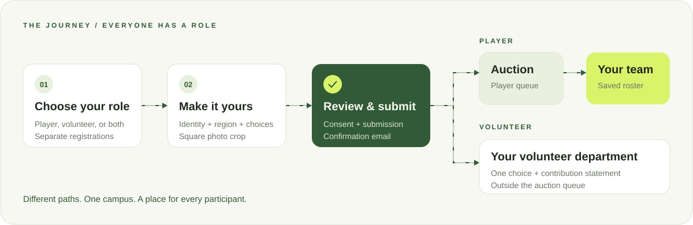

# BACHELORS BLITZ LANDING PAGE



An interactive campus sports website for the **Bachelor’s in Analytics and Sustainability Studies programme at TISS Mumbai**, with player and volunteer registration, a live Auction Dome, and an organiser console.

**Website:** [blitz-landing-theta.vercel.app](https://blitz-landing-theta.vercel.app/)

[Experience](#the-experience) · [Setup](#run-locally) · [Architecture](#how-it-connects) · [Workflow](#from-registration-to-team) · [Verification](#check-the-work) · [Deployment](#deployment-plan)

## The experience

| Area | What it does |
| :--- | :--- |
| Landing & spirit | Oversized BLITZ branding, the supplied TISS logo, illustrated sports equipment, and an interactive tug-of-war warm-up. |
| Rules & formats | Eight sport dialogs with animated entrances and glass-blurred backdrops, award points, and a connected knockout bracket. |
| Registration | Separate player and volunteer entries, institutional email selection, demographics, a zoomable India map, and a square photo crop editor. |
| Auction Dome | Live spectator view: all eight team purses in one line, the player on the floor (square photo, course, year, sports), the current bid and leading team, every team's logo and owner, recent sales, and a "Sold!" celebration with confetti. |
| Auction controls | Organiser-only auctioneer screen at `/admin/auction`: tap a team to raise the bid, then **Sold** (hammer), **Unsold**, or **Clear bids**. The next player loads automatically after a sale. Shows the player's gender, which never reaches the public feed. |
| Registration admin | Private signed admin sessions, searchable player/volunteer roster, full profiles and photos, role filters, CSV export, and a link to the auction controls. |
| Team rosters | Square team-logo cards with owner names, player count, purse left, and a squad popup. Teams without a logo show their colour and initials. |
| Bolt | A forest-green and lime chibi speedster with a big head, high-fives, page reactions, and four tricks: keep-ups, a lightning lap, a spin, and a flip. |

Touch navigation, safe-area spacing, native mobile scrolling, and reduced-motion fallbacks are implemented. Browser and physical-device verification status is recorded in [VERIFICATION.md](VERIFICATION.md).

### Eight sports. One connected bracket.

| Sport | Winner points | Runner-up points | Award categories |
| :--- | ---: | ---: | :--- |
| Football | 90 | 60 | Team |
| Cricket | 90 | 60 | Team |
| Dodgeball | 90 | 60 | Team |
| Chess | 90 | 60 | Event |
| Tug of war | 45 | 30 | Men and women, separately |
| Badminton | 30 | 20 | Men’s, women’s, and mixed doubles |
| Table tennis | 30 | 20 | Men’s, women’s, and mixed doubles |
| Power lifting | 15 | 10 | Each men’s and women’s weight category |

Power lifting categories: **Under 53, Under 59, Under 66, Under 74, Under 79, and Open**. The API uses `Weightlifting` as its canonical sport name.

The eight-team knockout diagram connects **A1 vs B4**, **A2 vs B3**, **B1 vs A4**, and **B2 vs A3** to four quarterfinal winners. Winners of QF1/QF2 meet in SF1; winners of QF3/QF4 meet in SF2. The two semifinal winners play the final. There is no third-place match or loser bracket. The rules page documents sport-specific formats separately, including Swiss chess.

Rules and award points are currently presentation data; fixture management, result entry, and persisted overall standings still need backend implementation.

## How it connects



The new backend runs on **Vercel + Supabase + an email provider**. Supabase mode needs no separate Python server. The existing FastAPI backend remains an explicit local option while the Supabase integration is rehearsed.

| Layer | Technology | Responsibility |
| :--- | :--- | :--- |
| Website | Next.js 16 · React 19 · TypeScript | Public pages, registration, organiser controls, and rosters |
| Motion | GSAP · Lenis · Three.js · SVG | Scroll choreography, mascot, sports scenes, and fallbacks |
| HTTP adapter | Next.js route handlers on Vercel | Input/photo validation, HttpOnly organiser sessions, and API compatibility |
| Auction rules | Supabase PostgreSQL functions | Authoritative commands, row locks, purse changes, assignments, and audit events |
| Accounts | Supabase Auth + private organiser allowlist | Named organiser sign-in; ordinary accounts cannot gain auction access |
| Photos | Private Supabase Storage bucket | Normalized square JPEGs with eligibility checks |
| Live updates | Supabase Realtime Broadcast | Change notifications followed by authoritative snapshot reads |
| Email | Database outbox + Edge Function + Gmail SMTP or Resend | Designed registration receipts and team/price announcements, immediate queue wake-ups, leases and retries |
| Local SQL checks | PGlite | Real PostgreSQL/PLpgSQL with platform service stubs |

A sale saves its assignment, purse deduction, audit event, email job, next lot, and public snapshot in one transaction. Command IDs prevent repeated effects and versions reject stale commands. Browser code never determines a legal price or directly writes a purse.

Private records live in the unexposed `blitz` schema. Spectators can read only a sanitized singleton projection. They receive no email addresses, verification tokens, demographic answers, or volunteer rationale. Public-channel messages are invalidations, never trusted auction data.

Email designs can be reviewed in [registration](docs/email-previews/registration.html) and [auction sale](docs/email-previews/assignment.html) previews. SVG source artwork is embedded as inline PNG images for Gmail compatibility. Registration is complete on submit; no email verification is required.

For registration emails from the chosen Google Workspace account, follow [Gmail SMTP setup](docs/SMTP_SETUP.md).

For removing the authorised dummy entries and their photos, follow [Pilot cleanup](docs/PILOT_CLEANUP.md).

For the current registration-first phase, follow [Registration and admin pilot](docs/REGISTRATION_PILOT.md). It includes the exact hosted activation commands and the hidden-password admin setup.

Start with [Supabase setup](docs/SUPABASE_SETUP.md) and the [SQL walkthrough](docs/SUPABASE_SQL.md), which explains all twelve migrations and the manual organiser/mail operations.

## From registration to team



### Participants

1. Choose **Player** or **Volunteer**. You can register for both using separate entries with the same institutional email.
2. Enter your email username and choose `stud.tiss.ac.in` or `tiss.edu`. Pasting a full supported email also works.
3. Complete identity, programme/year, age, gender, state or union territory, and “Have you played Bachelor’s BLITZ before?”
4. Players choose sports. Volunteers choose exactly one department—**Digital & Marketing, Operations, Medical, or Sustainability**—and explain their suitability and contribution.
5. Upload a photo, drag and zoom the **1:1 crop**, then review and consent. Only the confirmed 600 × 600 JPEG is uploaded.
6. Submit to complete registration and receive a confirmation email with your sports. Registered players become eligible for the auction; volunteers stay outside its queue.

The India map supports zooming, panning, and all 36 states and union territories, including Andaman and Nicobar. A dropdown remains available if the external map data cannot load.

### Organisers

**Configure teams → review registered players → start the auction → bid → sell or mark unsold → complete rapid rounds → allocate remaining players → review rosters and mail.**

Run the auction from **`/admin/auction`** (or the "Auction controls" button on `/admin`). The screen has three parts:

1. **Purse KPIs** — all eight teams in one line with their purse left; the leading team is highlighted.
2. **Player stage** — square photo, name, course (BSASS/BSW), year ("1st year", "2nd year", …), organiser-only gender, and sports. The bid panel on the right shows the current bid, the leading team, the next valid bid, and the **Sold** (hammer), **Clear bids**, and **Unsold** buttons. On tablets and phones the panel sits below the player.
3. **Team grid** — two rows of four team buttons (logo, name, owner). Each tap places that team's next bid: ₹20 → ₹25 → ₹30 → ₹35 … in the normal round. The leading team can't bid against itself, and a team whose purse is below the next bid is disabled.

**Sold** completes the sale in one press, with no confirmation dialog. Every screen, including spectators on `/auction`, shows a "Sold!" card with confetti in the winning team's colours, and the next player appears automatically. **Clear bids** asks for confirmation and is recorded in the audit log.

Starting the auction closes registration and freezes its registered-player queue. The organiser explicitly closes each sale; there is no automatic closing timer. The eight team purses start at **₹2,000 each** and carry across all rounds.

| Round | Opening bid | Increment |
| :--- | ---: | :--- |
| Normal | ₹20 | +₹5 up to ₹100, +₹10 up to ₹200, then +₹25 |
| Rapid 1 | ₹10 | +₹5 |
| Rapid 2 | ₹2 | +₹2 |
| Rapid 3 | ₹1 | +₹1 |
| Final allocation | Free | One player per team per shuffled cycle; saved once |

Unsold players move into the next round. A sale deducts the winning amount; teams with insufficient purses cannot bid. Active bids can be cancelled with an audit record. Final random allocation persists its result and cannot be rerolled.

See [WORKFLOW.md](WORKFLOW.md) for rehearsal cases and the development sequence.

## Run locally

Use **Node.js 22.18+**. To exercise the new database implementation without a Supabase account or Docker:

```bash
npm install
npm run test:supabase
```

For the complete local application, start Supabase with its CLI and a running Docker-compatible runtime:

```bash
npx supabase start
npx supabase status
```

Copy `.env.example` to `.env.local` if needed and select the new backend:

```dotenv
NEXT_PUBLIC_BACKEND_PROVIDER=supabase
NEXT_PUBLIC_SUPABASE_URL=http://127.0.0.1:54321
NEXT_PUBLIC_SUPABASE_PUBLISHABLE_KEY=your-local-publishable-key
SUPABASE_SECRET_KEY=your-local-server-secret
PUBLIC_URL=http://localhost:3000
ALLOWED_ORIGINS=http://localhost:3000,http://127.0.0.1:3000
```

```bash
npm run dev
```

Open [the website](http://localhost:3000), [Studio](http://127.0.0.1:54323), [the organiser console](http://localhost:3000/admin), or [the auction controls](http://localhost:3000/admin/auction). Follow the [setup guide](docs/SUPABASE_SETUP.md) to create an authorised organiser, test registration and confirmation mail locally, and configure the mail function. The secret key remains server-only. Rebuild/restart after changing public environment variables.

<details>
<summary>Existing FastAPI development mode</summary>

Select `NEXT_PUBLIC_BACKEND_PROVIDER=fastapi` and use Python 3.12 with uv:

```bash
uv venv backend/.venv --python 3.12
uv pip install --python backend/.venv/bin/python -r backend/requirements.txt
cp backend/.env.example backend/.env
```

Set unique admin/session secrets in `backend/.env`. Start the API and worker in separate terminals, alongside `npm run dev`:

```bash
cd backend
.venv/bin/uvicorn app.main:app --reload --port 8000
```

```bash
cd backend
.venv/bin/python -m app.worker
```

SQLite is the default for this legacy local mode. `docker compose up -d db mailpit` starts optional PostgreSQL and development SMTP; the connection template is in [backend/.env.example](backend/.env.example). Mailpit's UI is at [localhost:8025](http://localhost:8025). Next.js forwards API requests to `API_INTERNAL_URL` in this mode, and the browser uses `NEXT_PUBLIC_WS_URL` for live snapshots. Without a configured API, writes fail explicitly and the auction shows its labelled preview.

</details>

## Check the work

From the repository root:

```bash
npm run typecheck
npm run build
npm run test:mascot
npm run test:registration
npm run test:supabase
```

For browser checks, start the website and run:

```bash
npm run test:e2e
npm run test:mobile
```

Browser tests require Chromium. Set `CHROMIUM_PATH` to override `/usr/bin/chromium`, or `BLITZ_TEST_URL` to use another frontend address. Registration requests are intercepted; test submissions do not create event registrations or send emails.

The mobile suite covers 320, 360, 390, 430, 768, and 1024px widths plus 844 × 390 landscape: navigation, every sport dialog, bracket scrolling, both registration roles, touch cropping, map controls, long labels, and organiser tables.

For API and worker tests:

```bash
cd backend
.venv/bin/python -m pytest
```

Restricted environments that block event-loop socket wakeups can use `BLITZ_SANDBOX_TESTS=1` for the Python suite. See [VERIFICATION.md](VERIFICATION.md) for executed checks and remaining browser, device, PostgreSQL, and SMTP verification.

## Inside the repository

```text
blitz_landing/
├── src/
│   ├── app/                 Public routes, admin console, and responsive styles
│   ├── components/          Registration, sports art, mascot, and live interfaces
│   └── lib/                 Rules, map projection, cropping, and shared UI behavior
├── backend/
│   ├── app/                 FastAPI, auction service, persistence, and mail worker
│   ├── tests/               API, auction, registration, and worker checks
│   └── requirements.txt     Python dependencies
├── supabase/
│   ├── migrations/          Schema, permissions, auction, intake, and realtime
│   ├── functions/           Queued-mail Edge Function
│   └── operations/          Manual organiser bootstrap and mail scheduling
├── shared/                  Registration options shared by frontend and API
├── public/                  Website assets, map notes, and optional Rive artwork
│   ├── brand/               BLITZ header logo (transparent sticker cut-out)
│   └── teams/               Square team logos (512px WebP)
├── img/                     Supplied TISS logo
├── docs/                    Supabase setup, SQL lessons, and animated SVG artwork
├── tests/                   Frontend behavior and browser suites
└── docker-compose.yml       Local PostgreSQL and Mailpit
```

## Teams and logos

The eight team identities (id, name, colour, symbol) live in three places that must stay in sync:

| Where | Used by |
| :--- | :--- |
| `src/lib/event.ts` → `TEAMS` | Preview/offline state and the frontend |
| `backend/app/config.py` → `TEAMS` | The legacy FastAPI backend |
| A Supabase migration (`update blitz.teams … where id = N`, then republish the snapshot; see [SQL lessons](docs/SUPABASE_SQL.md)) | The live database, which is what the hosted site shows |

Logos and owners are frontend-only, in `TEAM_BRANDING` in `src/lib/event.ts`, keyed by team id:

```ts
4: { logo: "/teams/slytherwins.webp", logoBg: "#768262", owner: "Merry Geordy" },
```

`logoBg` is the colour shown while the image loads. Teams without an entry show their colour and initials, with "Owner to be announced".

**Logo format:** one square image, ideally 1080 × 1080. It's shown as given (full-bleed, no cropping or padding added) on the team cards, the squad popup, and the Auction Dome. Keep important artwork away from the very edges. Convert it to a 512px WebP into `public/teams/` (for example with `sharp`), then add the `TEAM_BRANDING` line.

All eight teams are confirmed:

| Id | Team | Owner | Migration |
| ---: | :--- | :--- | :--- |
| 1 | The Monarchs | Monalisa Murmu | `202610230017_the_monarchs.sql` |
| 2 | United Spartans | Vinayak Sarin | `202610230016_united_spartans_shell_mates.sql` |
| 3 | Shell Mates | Eesha Mishra | `202610230016_united_spartans_shell_mates.sql` |
| 4 | SlytherWins | Merry Geordy | `202610220012_slytherwins.sql`, renamed in `202610230014_shadow_strikers.sql` |
| 5 | X Force United | Wali Abidi | `202610220010_x_force_united.sql` |
| 6 | Vikings | Reha Tripathi | `202610220011_vikings.sql` |
| 7 | Shadow Strikers | Aditya Gupta | `202610230014_shadow_strikers.sql` |
| 8 | The Symbiotes | Prakhar Rai | `202610230015_the_symbiotes.sql` |

Team names are fixed once the auction starts. Apply new migrations with `npx supabase db push` before then; until a migration is applied, the hosted site keeps showing the old name even though the logo appears.

## Developer

Built and maintained by **Shreyit Sinha** — [GitHub](https://github.com/Shreyit) · [m2024bsas027@stud.tiss.ac.in](mailto:m2024bsas027@stud.tiss.ac.in). Found something broken? Get in touch; the site footer has the same contact pill.

## Deployment plan

The website deployment is [blitz-landing-theta.vercel.app](https://blitz-landing-theta.vercel.app/). Hosted database migrations, account/email setup, and the full registration/auction rehearsal are tracked separately from publishing the website.

Use **Vercel for Next.js**, **Supabase for PostgreSQL/Auth/Storage/Realtime/Edge Functions**, and a transactional email provider. No AWS account or separate backend machine is required in Supabase mode. The website and Supabase project have been created; database integration and hosted rehearsal remain pending.

The live-auction target is **up to 100 spectators with updates within one second**. Supabase mode uses event notifications, a 50ms fetch-coalescing window, and authoritative snapshot reads. Healthy subscribers stop four-second polling; disconnects resume it, and a 30-second checkpoint repairs missed notifications. These intervals are recovery behavior, not a one-second delivery guarantee. Networked concurrency, hosted integration, and action-to-screen latency require a real-stack load test.

Before opening the event, review migration targets, configure hosted Auth/SMTP, create allowlisted organisers, set Vercel environment variables and allowed origins, deploy/schedule the mail function, verify backups, and rehearse the full auction on the venue network. The server rate limiter uses shared database counters. Photos use a private bucket. Existing Python/SQLite data is not automatically imported.

Fixture/result persistence and calculated overall standings remain pending. See [verification](VERIFICATION.md) for the distinction between executed checks and remaining production rehearsal.

## Artwork and motion

This README uses local, self-contained **SVG artwork**, with animated court traces, connection paths, and workflow markers. Each SVG includes a static composition, accessible title/description, and a `prefers-reduced-motion` fallback. There are no emoji icons or external image services. Edit [hero.svg](docs/readme/hero.svg), [architecture.svg](docs/readme/architecture.svg), or [workflow.svg](docs/readme/workflow.svg) to adjust the artwork.

Website motion belongs to GSAP/Lenis and the Three.js mascot. SVG poses provide reduced-motion and WebGL fallbacks. The floating mascot stays out of the Auction Dome and the auction controls, so it never covers the bid panel. The optional Rive adapter uses its SVG fallback until an authored `.riv` file is supplied; see [animation asset notes](public/animations/README.md).

The India boundary data source and licensing are documented in [map asset notes](public/maps/README.md). Technical boundaries and transaction details are in [ARCHITECTURE.md](ARCHITECTURE.md).

For Vercel agent tooling, see the official [vercel/vercel-plugin](https://github.com/vercel/vercel-plugin). Install it in your coding environment with:

```bash
npx plugins add vercel/vercel-plugin
```

The plugin is development tooling; it is separate from the deployed Next.js application.
