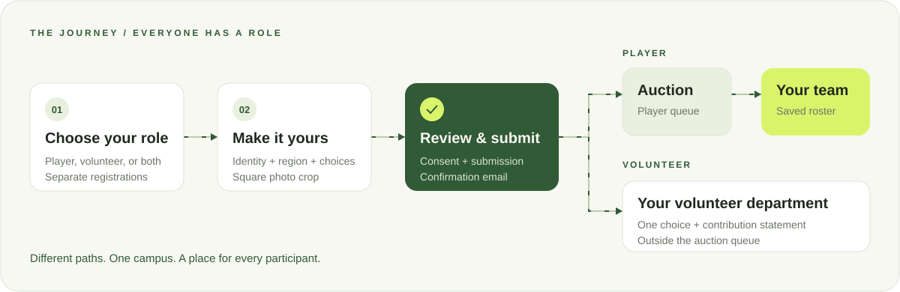

# Workflow

## Development sequence

1. Keep sport rules, award points, shared registration options, and event copy aligned.
2. Build the responsive public experience, SVG sports scenes, mascot reactions, and accessible dialogs.
3. Connect registration, square photo processing, email verification, and the persistent mail outbox.
4. Validate server-authoritative auction commands, authenticated controls, saved purses, and team rosters.
5. Complete event-driven live updates and production load tests for the one-second update target.
6. Add fixture management, result entry, and persisted overall standings.
7. Provision production services, verify backups and email delivery, and rehearse the complete event.

Steps 1–4 have implementations with verification limits documented in [VERIFICATION.md](VERIFICATION.md). The Supabase implementation also provides event-driven auction notifications, private Storage integration, named organiser accounts, and an Edge mail worker. Hosted rehearsal, latency/load testing, match-result persistence, and infrastructure rollout remain pending. Start locally with [Supabase setup](docs/SUPABASE_SETUP.md) and [the SQL walkthrough](docs/SUPABASE_SQL.md).

## Participant registration

Choose Player or Volunteer → institutional username/domain → identity and programme/year → age, gender, region, and previous participation → role-specific choices → square photo crop → review and consent → submit → verify email.

Players select sports. Volunteers select exactly one of Digital & Marketing, Operations, Medical, or Sustainability, then explain why they are suitable and how they can contribute. A participant can submit both roles using the same institutional email, as separate registrations. Volunteers never enter the auction queue.

The region field supports the zoomable India map and its dropdown fallback. The photo editor supports dragging, zooming, resetting, cancelling, and recropping from the original. Only a confirmed 600 × 600 JPEG is uploaded. Demographic details, volunteer rationale, and previous participation remain private to organiser views and exports.

## Organiser workflow

Start the local Supabase stack and Next.js → create an allowlisted organiser account → configure queued-mail processing or inspect disposable verification links locally → review registrations → log in at `/admin` → set eight team identities → start when verified players are ready → select a team to bid → explicitly sell or mark unsold → finish each round → allocate remaining players → inspect rosters, email status, and audit history.

The explicit `fastapi` development option instead uses the existing Python API/database/SMTP worker. Supabase mode does not require those processes and never silently routes writes to them.

Starting the auction freezes the verified-player queue and closes registration. A bid does not permanently deduct money: the final sale deducts the amount. Teams with insufficient purses cannot bid, and the current leader cannot bid against itself. Cancelling an active lot’s bids is audited. There is no automatic timer closing a player’s auction.

Normal round → rapid ₹10/+₹5 → rapid ₹2/+₹2 → rapid ₹1/+₹1 → final free allocation → complete. Only unsold players proceed to the next round. Team purses carry across rounds. Final shuffled allocation is saved once and cannot be rerolled.

## Rehearsal cases

- Supported email domains, pasted full email, duplicate registrations per role, and the same email across both roles.
- Required demographics, all states/union territories, map zoom/pan, and dropdown fallback.
- Exactly one volunteer department, contribution rationale, and volunteer isolation from public rosters and auction queues.
- Previous participation Yes/No; square crop dragging, zoom, cancellation, and recropping.
- Invalid image, excessive size, expired verification link, and public email privacy.
- First bid ₹20; transitions ₹95→₹100→₹110 and ₹190→₹200→₹225.
- A purse equal to the next bid is valid; a lower purse is rejected.
- Duplicate commands, stale versions, concurrent bids, and audited cancellation.
- Every round transition, persistence after refresh, socket reconnects, and venue-network latency.
- Random distribution with zero, fewer than eight, and more than eight players.
- SMTP failure/retry and no accidental re-enqueue after a sale.
- Keyboard navigation, mobile menu, every sport dialog, bracket scrolling, and reduced motion.

Use isolated development data. Supabase mode queues custom mail for its Edge Function/provider; FastAPI mode can use Mailpit. Run real-stack PostgreSQL concurrency tests and a spectator load test before the public event.

## Assets and configuration

The README illustrations are animated, self-contained SVGs in `docs/readme/`, with static reduced-motion views. The website uses local SVG sports art and a forest-green/lime Three.js chibi speedster. Keep the Three.js character and SVG fallback visually aligned when changing the mascot.

Bolt offers keep-ups, a lightning lap, a spin, and a flip through “Show a trick,” plus high-fives and page-specific reactions. Inline sports scenes follow route and supported sport context. The floating companion stays transparent and moves below forms on smaller screens. Keep mascots and the tug-of-war warm-up out of the Auction Dome.

The homepage tug-of-war reuses the vector portrait with team-colour shirts. Test opposing pulls, both winning directions, replay, team changes, and reduced motion. It is a browser-only warm-up and does not update official scores.

An authored Rive export can be placed in `public/animations/blitz.riv` and enabled using frontend environment variables; the adapter currently uses its SVG fallback. See [animation notes](public/animations/README.md).

Keep credentials in local environment files. Deploy `shared/registration-options.json` alongside `backend/`, configure persistent photo storage, and verify HTTPS, email links, backups, and allowed origins before opening the event.
